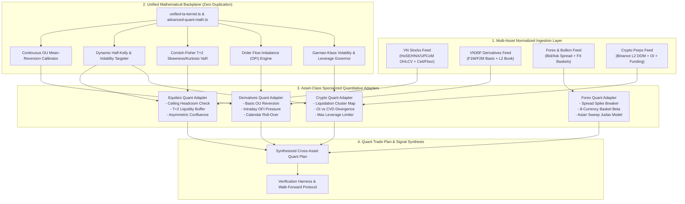

# Implementation Plan: Unified Cross-Asset Quantitative Trading Architecture

**Feature ID**: `003-unified-cross-asset-quant-enhancement`  
**Date**: 2026-11-20  
**Methodology**: GitHub Spec Kit (SDD) + Compound Engineering + Pragmatic Senior Dev Discipline  
**Status**: Planned  

---

## 1. System Architecture & Component Diagram

The quantitative architecture unifies all four trading domains under a single high-performance mathematical kernel while respecting the unique microstructure and settlement rules of each asset class:

---

## 2. Core Module Design & File Placements

### 2.1 Unified Engine: `src/lib/engines/unified-cross-asset-quant.ts`
Acts as the central quantitative gateway, exporting type-safe functions for:
1. `calculateCrossAssetKelly(params: KellyParameters): KellyResult`
2. `calculateT2SettlementRisk(returns: number[], lookback?: number): T2RiskMetrics`
3. `calibrateBasisOrnsteinUhlenbeck(basisSeries: number[], dtMinutes?: number): OUBasisCalibration`
4. `computeOrderFlowImbalance(prevBook: BookLevel3, currentBook: BookLevel3): OFIResult`
5. `evaluateForexSpreadSafety(currentSpread: number, historicalSpreads: number[], assetType: string): SpreadSafetyResult`
6. `computeGarmanKlassLeverageCap(ohlcSeries: OhlcBar[]): LeverageGovernorResult`
7. `detectCryptoLiquidationClusters(price: number, oi: number, atr: number): LiquidationClusterResult`

### 2.2 Integration into Existing Asset Services
- **Equities**: Integrate `calculateCrossAssetKelly`, `calculateT2SettlementRisk`, and `checkCeilingFloorHeadroom` into `src/lib/engines/asymmetric-quant-engine.ts` and `src/lib/services/screener-snapshot-service.ts`.
- **Derivatives**: Integrate `calibrateBasisOrnsteinUhlenbeck` and `computeOrderFlowImbalance` into `src/lib/engines/derivatives-arbitrage-engine.ts` and `src/lib/services/derivatives-scalp.ts`.
- **Forex**: Integrate `evaluateForexSpreadSafety` and multi-currency basket beta into `src/lib/engines/forex-order-flow-pro.ts` and `src/lib/engines/forex-currency-strength.ts`.
- **Crypto**: Integrate `computeGarmanKlassLeverageCap` and `detectCryptoLiquidationClusters` into `src/lib/engines/crypto-derivatives-engine.ts` and `src/lib/engines/crypto-position-sizer.ts`.

---

## 3. Mathematical Specifications & Algorithmic Rigor

### 3.1 Dynamic Fractional Kelly with Volatility Targeting
- Standard Kelly formula:
  $$f = \frac{p \cdot b - (1 - p)}{b}$$
- Fractional Kelly with Half-Kelly limit ($\kappa = 0.5$):
  $$f_{\text{kelly}} = \max\left(0.02, \min(0.25, f \times 0.5)\right)$$
- Annualized Volatility of Asset:
  $$\sigma = \text{std}(\text{returns}) \times \sqrt{252}$$
- Volatility Targeted Weight:
  $$w_{\text{final}} = f_{\text{kelly}} \times \min\left(1.5, \frac{\sigma_{\text{target}}}{\max(\sigma, 0.05)}\right)$$
  where $\sigma_{\text{target}} = 0.18$ ($18\%$ target volatility).

### 3.2 T+2 Settlement Cornish-Fisher VaR & CVaR
- Daily returns $R_t$. 2-day rolling returns:
  $$R_{2D, t} = (1 + R_t)(1 + R_{t-1}) - 1$$
- Sample statistics: mean $\mu$, standard deviation $\sigma$, skewness $S$, excess kurtosis $K - 3$.
- Cornish-Fisher quantile $z_{\text{CF}}$ for $\alpha = 0.05$ ($z_{0.05} = -1.64485$):
  $$z_{\text{CF}} = z_\alpha + \frac{S}{6}(z_\alpha^2 - 1) + \frac{K - 3}{24}(z_\alpha^3 - 3z_\alpha) - \frac{S^2}{36}(2z_\alpha^3 - 5z_\alpha)$$
- $95\%$ T+2 VaR:
  $$\text{VaR}_{95\%}(T+2) = \max\left(0, -(\mu + z_{\text{CF}} \cdot \sigma)\right)$$

### 3.3 Continuous Ornstein-Uhlenbeck Basis Calibration
- Given intraday basis samples $X_1, X_2, \dots, X_N$ observed at intervals $\Delta t = 1$ minute:
- Fit discrete regression:
  $$\Delta X_t = X_t - X_{t-1} = a + b X_{t-1} + e_t$$
- Guard against non-stationary or exploding processes:
  $$\text{Valid if } -1.0 < b < -0.001$$
- Continuous parameter extraction:
  $$\theta = -\frac{\ln(1 + b)}{\Delta t}$$
  $$\mu = -\frac{a}{b}$$
  $$\sigma_e = \sqrt{\frac{1}{N-2} \sum e_t^2}$$
  $$\sigma_{\text{eq}} = \frac{\sigma_e}{\sqrt{2\theta}}$$
  $$t_{1/2} = \frac{\ln(2)}{\theta}$$
- Basis Z-Score:
  $$Z_{\text{basis}} = \frac{X_t - \mu}{\sigma_{\text{eq}}}$$

### 3.4 Microstructure Level 2 Order Flow Imbalance (OFI)
- Track best 3 bid/ask price levels $(P_b^{(k)}, Q_b^{(k)})$ and $(P_a^{(k)}, Q_a^{(k)})$ for $k \in \{1, 2, 3\}$.
- Bid side flow contribution:
  $$\Delta Q_b^{(k)} = \begin{cases} Q_{b, t}^{(k)} & \text{if } P_{b, t}^{(k)} > P_{b, t-1}^{(k)} \\ Q_{b, t}^{(k)} - Q_{b, t-1}^{(k)} & \text{if } P_{b, t}^{(k)} = P_{b, t-1}^{(k)} \\ -Q_{b, t-1}^{(k)} & \text{if } P_{b, t}^{(k)} < P_{b, t-1}^{(k)} \end{cases}$$
- Ask side flow contribution:
  $$\Delta Q_a^{(k)} = \begin{cases} -Q_{a, t}^{(k)} & \text{if } P_{a, t}^{(k)} < P_{a, t-1}^{(k)} \\ Q_{a, t-1}^{(k)} - Q_{a, t}^{(k)} & \text{if } P_{a, t}^{(k)} = P_{a, t-1}^{(k)} \\ Q_{a, t-1}^{(k)} & \text{if } P_{a, t}^{(k)} > P_{a, t-1}^{(k)} \end{cases}$$
- Composite OFI:
  $$\text{OFI}_t = \sum_{k=1}^3 \left( \Delta Q_b^{(k)} + \Delta Q_a^{(k)} \right)$$
- Normalized OFI:
  $$\text{NOFI}_t = \frac{\text{OFI}_t}{\sum_{k=1}^3 (Q_{b, t}^{(k)} + Q_{a, t}^{(k)})}$$

---

## 4. Verification & Validation Strategy

1. **Unit Testing (`src/lib/__tests__/cross-asset-quant-engines.test.ts`)**:
   - Math unit tests verifying exact convergence of OU calibration, CF VaR, OFI, and Kelly formulas.
   - Boundary tests: Zero volume, negative basis, extreme kurtosis, zero variance, and flash crash scenarios.
2. **Causal Invariance Tests**:
   - Verify that modifying future data does not alter earlier signals or risk metrics.
3. **Cross-Asset Benchmarking**:
   - Verify consistent execution latency $< 5\text{ms}$ per symbol evaluation and $< 50\text{ms}$ for full composite scans.
4. **End-to-End Build & Test Verification**:
   - `npx tsx --test src/lib/__tests__/cross-asset-quant-engines.test.ts`
   - `npx tsx --test src/lib/__tests__/core-algorithm-purification.test.ts`
   - `npx tsc --noEmit`
   - `npm run build`
